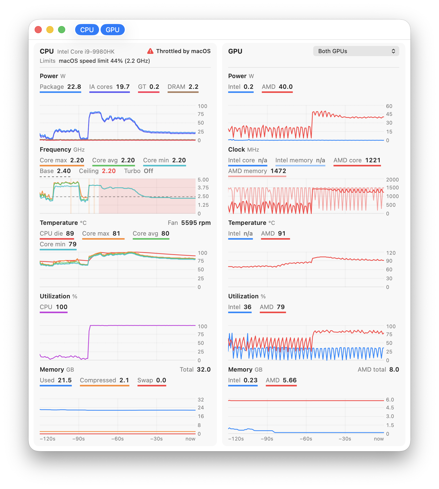
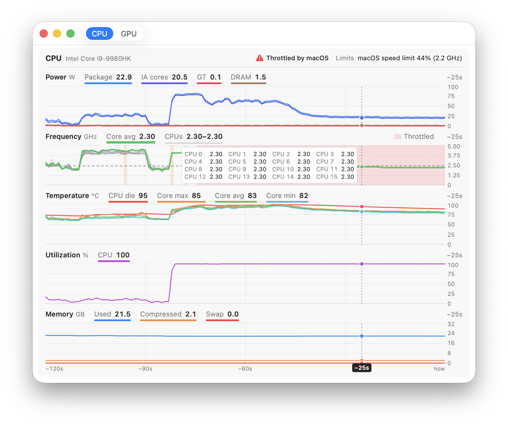

# Power Gauge

Inspired by Power Gadget, it uses powermetrics and driver readings to plot an Intel Mac's CPU
and GPU power, clocks, temperatures, utilisation and memory use, and shows when and why the CPU
is throttled.

<picture>
  <source media="(prefers-color-scheme: dark)" srcset="docs/images/window-dark.png">
  
</picture>

## Install

**Intel Macs, macOS 11 or later.** Apple Silicon isn't supported. Tested on a 16-inch MacBook Pro
(2019) and a 15-inch MacBook Pro (2014), both on macOS 26; readings vary by hardware.

[Download the latest release](https://github.com/ChrisLie45/Power-Gauge/releases/latest), unzip it,
and move **Power Gauge** to Applications. The app isn't notarised, so if macOS blocks it, use
**Open Anyway** in its security settings.

## Using it

- **Start Monitoring** (⌘R) asks for an administrator password to run `powermetrics`.
  **Stop Monitoring** (⌘.) or quitting stops it.
- **View:** CPU/GPU cards (⌘1/⌘2), per-core frequencies (⌘3), and 2, 5 or 10 minutes of history.
  Hover over a plot for past readings.
- **Record to CSV…** (⇧⌘R, Monitor menu) saves a row every second.
- **Menu bar:** the fastest core's frequency, with a warning for heat, macOS throttling or PROCHOT.
  Closing the window keeps monitoring; quit from the menu to exit.

<picture>
  <source media="(prefers-color-scheme: dark)" srcset="docs/images/per-core-dark.png">
  
</picture>

### Reading the plots

- **Red bands:** thermal throttling, PROCHOT or macOS limiting the CPU.
- **Amber bands:** power/current limits or Low Power Mode; expected under heavy load.
- **Limits unknown:** the processor's limit bits couldn't be read; macOS's limits still apply.
- **High frequency at idle:** frequency averages only the time the CPU was active.

**Monitor > CPU Readings > Kernel, No Password (Experimental)** avoids the password and catches
short turbo bursts. Readings may be wrong or missing; there's no Intel GPU clock. If it fails,
it falls back to powermetrics and asks for a password.

[Reading sources, GPU utilisation options and limitations](docs/readings.md).

## Command line

Print live CSV using the sources chosen in the app; stop with Ctrl-C:

```bash
"/Applications/Power Gauge.app/Contents/MacOS/PowerGauge" --print-csv > readings.csv
```

Powermetrics still needs a password. Avoid running alongside another GPU monitor, including the
app, since reads can disturb GPU utilisation. Use `--help` for all options.

## Reporting problems

Choose **Help > Save Diagnostic Report…** and attach it to an
[issue](https://github.com/ChrisLie45/Power-Gauge/issues). It includes hardware and readings,
with nothing personal.

## Building and testing

Needs an Intel Mac and the Command Line Tools (`xcode-select --install`).

```bash
scripts/build.sh   # builds build/Power Gauge.app
scripts/test.sh    # builds and tests offscreen; no password or saved-setting changes
```
