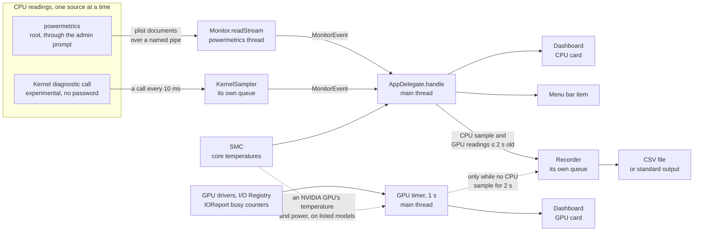
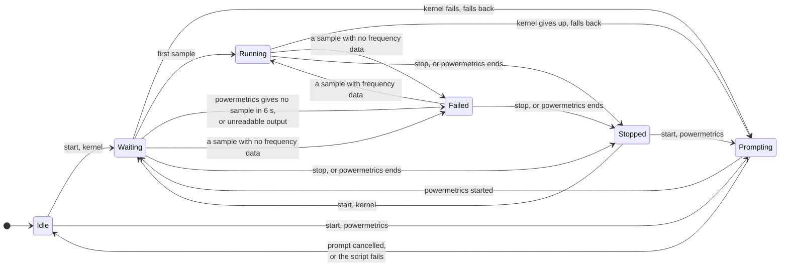
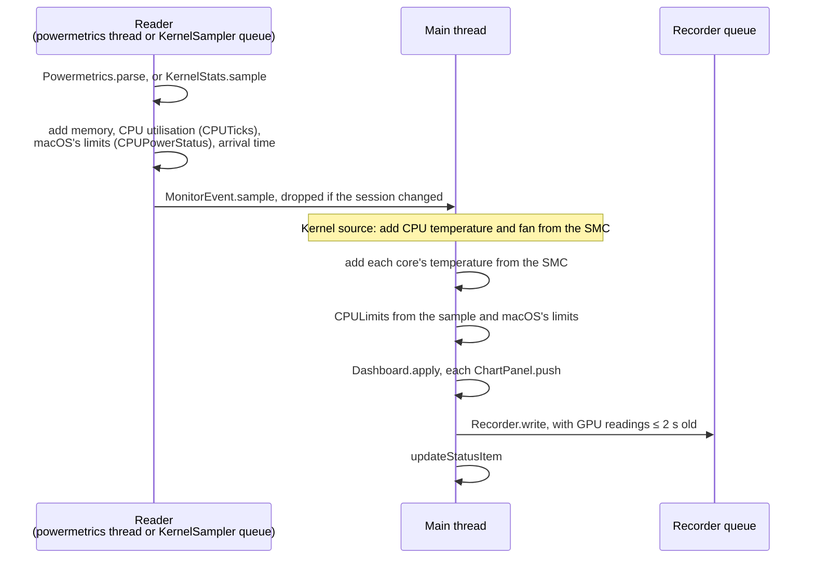

# Architecture

Reading sources have their own docs: [cpu-readings.md](cpu-readings.md),
[hardware-readings.md](hardware-readings.md).

## At a glance

- **AppKit and Swift, with one C file.** No dependencies, no Xcode project.
- **Intel only** (x86_64), macOS 11 and later.
- **One reading a second.** CPU readings come from powermetrics or the kernel. The app reads the
  GPUs, the SMC and macOS's own figures itself.
- **`AppDelegate` feeds everything on the main thread:** the window, the menu bar item and any
  recording.

## Layout

| Path | What it holds |
|---|---|
| `Sources/PowerGauge/` | The app (below) |
| `Sources/CDiag/` | The kernel call for the kernel readings, in C, since Swift has no inline assembly |
| `Resources/` | `Info.plist`, and the icon's Icon Composer source with its compiled `Assets.car` and `AppIcon.icns` |
| `scripts/` | Building, testing, the throttle survey, and `make-icon.sh`, which needs Xcode 26 |
| `Tests/` | powermetrics samples, throttle surveys, expected outputs and root-script checks |
| `docs/` | These docs, and the README's screenshots in `images/` |
| `.github/` | Issue templates, the build workflow and the release notes |
| `Package.swift` | For editors and `swift build`; the app itself comes from `scripts/build.sh` |

| `Sources/PowerGauge/` | What it holds |
|---|---|
| `App/` | `main`, the `--help` text (`Usage`), and `AppDelegate` with an extension for each part of the app |
| `Monitoring/` | Starting and stopping the readings, and one second's sample |
| `Powermetrics/` | Reading powermetrics' samples, and the script that runs as root |
| `Kernel/` | The experimental kernel readings |
| `Hardware/` | What macOS reports without privileges, the SMC, and the GPUs |
| `Limits/` | What is limiting the CPU, of what kind, and the limit bits by processor generation |
| `Recording/` | The CSV recording |
| `Report/` | The diagnostic report |
| `Views/` | The dashboard, its cards and their chart rows |
| `TestModes/` | The test modes `scripts/test.sh` runs, and the made-up hardware they use |
| `Units.swift` | Unit conversions |

## Building

- **`scripts/build.sh` builds the app.** `clang` compiles `Sources/CDiag/CDiag.c`, and `swiftc`
  compiles every `.swift` file in `Sources/PowerGauge` as one module, with `CDiag.h` as the
  bridging header. The script then adds `Info.plist` and the precompiled icon, signs ad hoc, and
  replaces the app in `build/` only if every step passed.
- **`Package.swift` is for editors and `swift build`,** to type-check and index. It doesn't make
  the app bundle.
- **Swift 5.4 on Big Sur must build it.** With that compiler `build.sh` selects the Big Sur 11.3
  SDK if it is installed at `/Library/Developer/CommandLineTools/SDKs/MacOSX11.3.sdk`; otherwise
  it uses the compiler's default SDK. Newer SDK features need `#if compiler(>=…)` as well as
  `#available`.
- **C only where Swift can't:** `CDiag.c` is the one system call, which needs inline assembly.

## Startup

1. **`main.swift` handles flags that exit before the app exists.** `Usage.printIfAsked()` prints
   the help for `--help` or `-h`, then `TestModes.run()` runs any test mode
   ([testing.md](testing.md)). A new command-line option belongs in `Usage.text`.
2. **`NSApplication` starts with an `AppDelegate`.** `--print-csv` sets the activation policy
   to `.prohibited`: no Dock icon, menu bar or window.
3. **`applicationDidFinishLaunching`** builds the menu bar item, menus and window, restores view
   options and window frames, loads the sources (`loadSources()`), connects `Monitor.onEvent` to
   `handle`, and starts the GPU timer if the GPU card is open. Monitoring waits for the user,
   except with `--stream`, which is read at once.
4. **`persists` is set only here,** so only the app proper writes the user defaults. Test modes
   build the same window without it.

`--print-csv` branches at step 3 (`startPrinting()`). It makes a `Recorder` on standard output,
starts monitoring at once, sends events to standard error, and exits when monitoring ends
([window.md](window.md)).

## Monitoring: `Monitor`

`Monitor` runs one monitoring session at a time and reports each change as a `MonitorEvent` on
the main thread. `AppDelegate.handle` maps events to a `MonitorState`, which drives the
dashboard, the menu bar item and the Start button. A sample's state is set by `Dashboard.apply`:
Running, or Failed for a sample with no frequency data.

powermetrics that ends before its first sample, as when it turns down every set of arguments,
goes from Waiting straight to Stopped, with its complaints as the reason.

- **Sessions:** every start, stop and fallback increments `Monitor.session`. Results from reader
  threads carry their session and are dropped if it has changed, so a stream still draining
  after a stop can't reach the window.
- **Fallback:** a kernel failure is kept as `kernelProblem`. Every start then uses powermetrics
  until the app is relaunched or the user chooses the kernel again (`retryKernel()`).
- **Stopping powermetrics:** the app creates a stop file in the user's temp folder, which the
  root script watches. It never signals the root process.
- **App Nap:** while monitoring or recording, `updateActivity()` holds a
  `userInitiatedAllowingIdleSystemSleep` activity. Samples continue with the window hidden, and
  the Mac can still sleep.

## One second's sample

A `Sample` is one second of CPU readings, the same struct whichever source made it. It gains
readings on two threads:

- **The SMC is main-thread only,** since it has no locks. So `handle` adds core temperatures,
  not the reader.
- **Gaps:** samples are timed by uptime, which stops during sleep. A wait of 2.5 s or more pushes
  empty slots, so the plots show a gap instead of joining across it.
- **Rows store 601 slots** (`ChartPanel.storage`, ten minutes plus one), whatever history is
  shown.

## GPU readings

- **A main-thread timer reads every GPU each second** (`startGPUReadings()`). It starts when the
  GPU card first opens or a recording starts, since reading a driver's statistics disturbs other
  GPU monitors' figures. It then keeps running, so reopened rows have no holes. Its 0.1 s
  tolerance lets macOS group it with other wake-ups.
- **The integrated GPU's power and clock come from the CPU sample,** since its driver reports
  neither. `Dashboard.apply(gpu:)` fills them in from a CPU sample under 3 s old.
- **Recording rows:** each CPU sample writes a row with the GPU readings from the last 2 s. After
  2 s without a CPU sample, the GPU timer writes rows itself, so recording works with or without
  monitoring.

## Threads

| Thread | What runs there | How it hands back |
|---|---|---|
| Main | The UI, the SMC, `Monitor`'s state, the GPU timer, `AppDelegate` | |
| powermetrics, a global queue | `RootScript.runAsAdministrator` waiting on `osascript`'s prompt, then `Monitor.readStream`: blocking reads on the pipe, `PlistStream`, `Powermetrics.parse` | `DispatchQueue.main.async`, checked against the session |
| Opening the kernel readings, a global queue | `KernelStats.open`: the `--kernel-probe` child process (up to 5 s), then test readings to find the record layout | `DispatchQueue.main.async`, checked against the session |
| KernelSampler queue | The kernel call every 10 ms, bursts, and each second's `KernelStats.sample` | `onSample` and `onGiveUp` on the main queue |
| Recorder queue | Formatting and writing CSV rows, with `F_FULLFSYNC` for files | `onError` on the main queue |

New hardware reads off the main thread follow the same pattern: slow work on its own queue, hand
back with `DispatchQueue.main.async`, and drop the result if whatever asked for it has stopped.

## Quitting

`applicationWillTerminate` closes any open admin prompt (`RootScript.closePrompts()`), waits for
the recording's last row (`closeAndWait()`), and removes this process's stop files. powermetrics
doesn't rely on a clean quit: the root script's watcher stops it and removes its folder once the
app's process is gone.

## Test seams

`--app-check` runs the real `AppDelegate` offscreen, with stand-ins set through these
properties:

| Property | In the app | In the app check |
|---|---|---|
| `Monitor.runScript` | `RootScript.runAsAdministrator`, through the admin prompt | Runs the script as the user, with a stand-in for powermetrics |
| `Monitor.folderPrefix` | `/tmp/powergauge.` | A folder of the test's own |
| `Monitor.openKernel` | `KernelStats.open` | This Mac's kernel first, where it can be read, then made-up kernel readings (`MadeUpKernel`) |
| `AppDelegate.confirmKernel` | An alert | Answers without one |
| `AppDelegate.persists` | `true` | `false`, so no settings are written |

The app check reads this Mac's real GPUs. `MadeUp` supplies the made-up GPUs and readings of
`--snapshot` and `--csv-check`, the same on any Mac. To make new code testable, add a property
like these, not a flag checked inside it.
